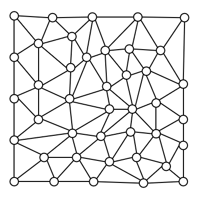
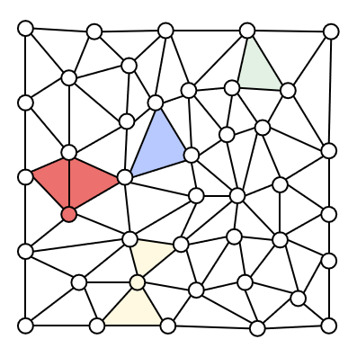

# WPS 演示自动填色

> [!IMPORTANT]
> **普通用户请从 [Releases 页面](https://github.com/rrrxxxvvv/WPS_AutoFill_WPP/releases/latest) 下载 `wps-autofill-wpp.exe`，不要下载页面自动生成的 Source code 压缩包。**
>
> 1. 保存并关闭 WPS；
> 2. 双击 `wps-autofill-wpp.exe` 完成安装；
> 3. 重新打开 WPS 演示；
> 4. 点击顶部 **自动填色 → 自动生成填色区域**。
>
> 安装和使用不需要 Node.js，也不需要编写代码。第一次使用请阅读 [普通用户使用指南](docs/USER_GUIDE.md)。安装包尚未进行代码签名，Windows 可能显示“未知发布者”，请确认文件来自本仓库的 Releases 页面。

一个面向 WPS 演示 Windows 桌面版的 JS 加载项。它可以识别幻灯片中的闭合区域，并生成可独立选择、换色和删除的无边框填色形状。

当前版本 **v0.3.0**：读取 PPTX 真实几何并生成原生可编辑曲边，修复候选区域转全部填充时的偏移，以及曲线交点遗漏导致的串区。详见 [更新记录](CHANGELOG.md)。升级后需要重新生成旧版的错误色块，安装更新不会自动修复已有对象。

项目支持三类图形：

- 一个闭合外框及其内部的分割直线；
- 由椭圆节点和连接线段构成的平面线网；
- 多个重叠多边形、直线与自由曲线组成的通用线稿。

## 效果展示

| 填色前 | 填色后 |
| --- | --- |
|  |  |

## 功能特性

- 从 PPTX 的真实 OOXML 几何中读取标准预设形状、黄色调节点、连接符和任意多边形路径；
- 识别椭圆节点线网中的全部有界面，自动排除最外层无限区域；
- 识别重叠闭合形状、开放直线和自由曲线的交点，并提取形成的闭合面；
- 自动递归展开 WPS 组合对象，可直接扫描组合中的子图形；
- 线网区域使用“实际线段截段 + 节点椭圆弧”作为边界，不直接连接圆心；
- 可将每个椭圆节点内部作为独立候选区域；
- 支持手动挑选一个或多个区域，也支持一次填充全部区域；
- 生成形状无轮廓，并自动置于原轮廓和连接线下方；
- 支持填充颜色、不透明度、曲边精度和同色系调色板；
- 内置经典颜色，并可在本机临时保存最多 8 个常用颜色；
- 支持对已生成区域换色，以及清理当前页全部候选和生成区域。

## 识别模式

| 模式 | 图形结构 | 操作前的选择状态 |
| --- | --- | --- |
| 外框模式 | 1 个闭合外框 + 若干分割直线 | 只需选中外框；需要精确控制时选中全部对象 |
| 线网模式 | 多个椭圆节点 + 连接节点的线段 | 点击幻灯片空白处，取消所有选择 |
| 通用线稿模式 | 重叠多边形、直线、开放或闭合自由曲线 | 取消选择扫描当前页，或选中需要参与识别的对象 |

### 外框模式

分割线需要完整穿过外框，建议让线段两端稍微伸出外框边缘。插件会构造外框与分割线形成的平面图，并提取其中的闭合区域。

### 线网模式

每条线段的两端应连接到椭圆边缘，线段交叉处应有一个椭圆节点，外围线网也需要闭合。

线网闭合面的边界由以下部分组成：

1. 两个相邻椭圆之间的实际线段截段；
2. 同一节点上两条相邻连线之间的椭圆弧。

因此生成边界不会穿过圆心。勾选“线网模式包含椭圆内部区域”后，每个椭圆内部也会成为可单独填色的区域。

### 通用线稿模式

当页面不符合前两种结构时，插件会先通过 `SaveCopyAs` 创建当前演示文稿的临时 PPTX 副本，再读取活动页中的 `prstGeom/avLst` 或 `custGeom/path`。因此黄色调节点、直线、圆弧和贝塞尔控制点都来自文件中的真实几何，不再依赖 WPS 12.1 中会返回空值的 `Nodes/Vertices` 接口。随后插件计算路径交点，并从平面图中提取所有有界面。

组合对象会自动展开读取，不需要先在 WPS 中取消组合。扫描期间任务窗格会显示“正在扫描”；如果没有形成区域，错误信息会列出扫描对象数、成功读取的路径数和部分未读取对象。

### 160 个对象回归基线

仓库内的两页测试文件覆盖 160 个对象，其中 113 个在第二页修改了黄色调节点。当前自动化测试将它们按可见路径分类并逐个验证：

- 96 个单一闭合轮廓；
- 38 个多子路径对象；
- 64 个包含曲线；
- 135 个单独使用时能形成至少一个候选区域；
- 25 个属于开放线稿或分割线，本身不形成填色面，需要与其他边界组合使用。

这里的“读取成功”只代表路径读取和结构检查通过，不等于每一种形状与任意其他形状组合都已在所有 WPS 版本中验证。160 是夹具对象数，并非 160 种预设的全部参数组合已经验收。实测证据及未完成项见 [曲边修复验证记录](docs/RUNTIME_VALIDATION.md)。

## 开发环境要求

- Windows；
- WPS 演示桌面版；
- Node.js；
- WPS JS 加载项开发工具 `wpsjs`。

## 快速开始

如果你只是想安装和使用插件，不需要执行下面的开发命令，请直接阅读 [普通用户使用指南](docs/USER_GUIDE.md)。

### 1. 安装依赖

```powershell
npm install --registry=https://registry.npmmirror.com
```

如尚未安装 WPS 开发工具：

```powershell
npm install -g wpsjs --registry=https://registry.npmmirror.com
```

### 2. 启动调试

```powershell
wpsjs debug
```

WPS 演示启动后，打开顶部的“自动填色”选项卡，再点击“自动生成填色区域”打开任务窗格。

如只需要在浏览器中调试任务窗格页面，可另行运行：

```powershell
npm run dev
```

修改代码后如未看到新界面或新逻辑，请刷新加载项页面，或停止并重新运行 `wpsjs debug`。

## 使用方法

### 第一步：确定识别范围

- 外框模式：只需点击一个闭合外框，插件会自动读取当前页直线；如页面含无关直线，也可按住 `Ctrl` 精确选中外框和需要的分割线；
- 线网或通用线稿模式：点击幻灯片空白处，确保当前没有选中任何对象；也可以先框选需要参与通用识别的对象。

### 第二步：设置填充样式

任务窗格支持：

- 自定义取色器；
- 经典颜色快捷色块；
- 临时颜色：点击“保存当前”保存，点击色块复用，右键色块可单独移除；
- 不透明度；
- 曲边精度；
- 同色系调色板；
- 是否包含椭圆节点内部；
- 是否关闭原外框或节点填充、仅保留轮廓。

临时颜色保存在当前设备的任务窗格本地存储中，最多保留 8 个。

### 第三步：选择填色方式

#### 手动挑选区域

1. 点击“开始点选”；
2. 插件会用浅色显示所有可选区域；
3. 到幻灯片中逐个点击目标区域内部的圆形定位点，无需按住 `Ctrl`；
4. 已点选区域会加深，再点同一定位点可取消；
5. 返回任务窗格，点击“完成并填充”。

未选中的候选区域会在填充完成后自动删除。

WPS 会为所有自由形状显示矩形外接控制框，这个原生控制框无法改成贴合曲线的形状。插件采用“点击后立即记录并取消原生选择”的方式，使控制框只短暂出现；是否选中请以候选区域是否加深为准。

#### 一次填充全部

点击“填充全部识别区域”。插件会直接生成识别范围内的所有闭合面；如果启用了椭圆内部区域，也会同时生成这些区域。

### 管理已生成区域

- 换色：在幻灯片中选中一个或多个已生成区域，再点击“给选中区域换色”；
- 清理：点击“清理本页生成区域”，删除本页所有候选和已生成区域。

## 当前限制

- 目前面向 WPS 演示 Windows 桌面版；
- 需要 WPS 提供 `SaveCopyAs` 与 `FileSystem.ReadFileAsArrayBuffer`；演示文稿受保护而无法创建临时副本时会停止并明确提示；
- 外框专用模式的分割对象仍需是直线；曲线、弧线或折线路径由通用线稿模式处理；
- 外框模式不支持端点停在外框内部的短线；
- 自由形状外框必须闭合；
- 曲线交点使用原始贝塞尔参数计算；色块写成原生 DrawingML 后导入，绕过部分 WPS 构建会重拟合控制点的自由形状创建接口；
- OOXML 圆弧拆成不超过 45° 的三次贝塞尔子段，误差低于插件的视觉与拓扑容差；
- 线网模式中，没有连接到两个椭圆节点的线段会被忽略。
- 不相交的嵌套轮廓使用复合路径孔洞；相切、近重合和复杂组合仍需按实际文稿验收。
- 原生导入使用 WPS 复制/粘贴通道，会替换系统剪贴板内容；临时文稿只在本机生成，导入后清理。
- 复杂自由形状仍会在 WPS 中短暂出现矩形外接控制框；插件会自动取消该原生选择，以免持续遮挡相邻区域。

## 实现原理

### 外框模式

1. 将曲边外框采样为高密度多边形；
2. 计算外框边与分割直线的交点；
3. 构造平面图；
4. 遍历有界面并生成独立区域。

### 线网模式

1. 读取椭圆中心、半径和线段端点；
2. 将每条线段端点匹配到相邻椭圆；
3. 按节点出边角度遍历平面图中的有界面；
4. 根据实际连线方向计算椭圆交点；
5. 使用直线截段和椭圆弧重建真实区域边界。

### 通用线稿模式

1. 创建临时 PPTX 副本，并按活动幻灯片与形状 ID 读取 OOXML 几何；
2. 使用 ECMA-376 预设公式和实际 `avLst` 黄点值计算轮廓，自由形状直接读取 `custGeom`；
3. 沿原始曲线参数进行自适应采样；
4. 计算所有线段与曲线交点，并在交点处分割路径；
5. 合并重合顶点和边，构造统一平面图；
6. 遍历并生成所有有界闭合面。

面板的生成入口将直线和曲线写成 PPTX 原生 `custGeom` 路径，再通过隐藏临时文稿导入可编辑形状。原有 `BuildFreeform`/`AddPolyline` 代码保留供旧接口测试与调试使用，不再作为面板的色块生成路径。生成对象名称以 `WPS_AutoFill_` 开头，候选区域名称以 `WPS_AutoFill_Preview_` 开头。

## 项目结构

```text
WPS_AutoFill_WPP/
├─ .github/                 # CI、依赖更新及协作模板
├─ assets/                  # ECMA-376 标准预设形状定义
├─ js/
│  ├─ ooxml-geometry.js    # PPTX 解包、预设公式与自由路径解析
│  ├─ fill-engine.js       # 图形识别、平面图算法和 WPS 形状创建
│  ├─ ribbon.js            # Ribbon 交互
│  ├─ taskpane.js          # 任务窗格交互
│  └─ util.js
├─ ui/
│  ├─ taskpane.html
│  └─ taskpane.css
├─ tests/
│  ├─ fixtures/adjusted-shapes.pptx # 原始/黄点调整配对夹具
│  ├─ ooxml-geometry.test.js # 160 个真实对象的 OOXML 回归测试
│  ├─ shape-support.test.js # 160 个对象的分类与端到端能力矩阵
│  ├─ geometry.test.js     # 几何与平面图测试
│  └─ wps-mock.test.js     # WPS API 模拟工作流测试
├─ manifest.xml
├─ ribbon.xml
├─ vite.config.js
├─ CONTRIBUTING.md
├─ LICENSE
└─ package.json
```

## 开发命令

```powershell
# 启动 Vite 开发服务器
npm run dev

# 运行几何和 WPS 模拟测试
npm test

# 生成生产构建
npm run build

# 生成供普通用户安装的 Windows EXE
npm run package:exe

# 按 WPS 官方流程发布
wpsjs publish
```

生产构建输出位于 `dist/`。

## 打包与发布

普通用户发布建议使用 Windows 自解压安装包：

```powershell
npm ci
npm test
npm run package:exe
```

安装包生成在：

```text
wps-addon-build/wps-autofill-wpp.exe
```

打包前应先在 `package.json` 中更新 `version`，并确保 `npm test` 与 `npm run build` 均通过。将生成的 EXE 上传到 GitHub Release，并在发布说明中附上 [普通用户使用指南](docs/USER_GUIDE.md)。

这个 EXE 是由 `wpsjs` 生成的自解压安装程序，会把插件复制到当前 Windows 用户的 WPS JS 加载项目录，并写入加载配置。由于安装包未进行代码签名，Windows 或安全软件可能显示未知发布者提示；正式面向公众发布时，建议使用可信代码签名证书签名。

如果需要部署在线版本，可运行 `wpsjs publish`，并按照命令行提示配置静态资源服务器。在线部署需要长期可访问的 HTTPS 地址和版本维护，不适合作为首次发布方式。

## 常见问题

### 点击操作后提示没有选中对象

确认当前使用的识别模式：

- 外框模式至少需要选中一个闭合外框；
- 线网和通用线稿模式可取消所有选择，让插件扫描当前页；
- 页面上有无关对象时，可以先框选所有需要参与通用识别的路径。

### 部分线段没有参与识别

检查线段两端是否确实靠近两个椭圆边缘。任务窗格状态会显示被忽略的未连接线段数量。

### 椭圆内部填色不可见

同时勾选：

- “线网模式包含椭圆内部区域”；
- “关闭原外框/节点填充，只保留轮廓”。

否则原椭圆自身的不透明填充可能遮住生成区域。

### 修改代码后 WPS 仍显示旧版本

先保存文稿，完全退出 WPS 后重新打开。仅关闭再打开任务窗格可能仍沿用旧脚本。开发模式还需确认本地开发服务正在运行。

## 参与开发

欢迎提交 Issue 或 Pull Request。开始前请阅读 [贡献指南](CONTRIBUTING.md) 和 [社区行为准则](CODE_OF_CONDUCT.md)。涉及几何算法的修改建议同时补充 `tests/geometry.test.js`；涉及 WPS 交互的修改建议补充 `tests/wps-mock.test.js`。

如发现安全问题，请按照 [安全策略](SECURITY.md) 私下报告，不要在公开 Issue 中披露漏洞细节。

## 许可证

本项目采用 [MIT License](LICENSE) 开源。
